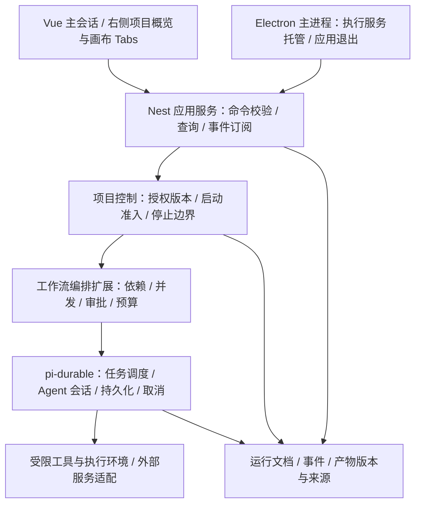

# HCode 多 Agent 项目空间与可视化编排实现方案

日期：2026-10-22。范围：架构、交互、数据边界、实施顺序和验收要求；本次不修改业务代码。

## 1. 目标与已确定的约束

把 HCode 从单会话工具扩展为通用的多 Agent 工作空间。视频制作、游戏制作和代码开发通过不同的角色、工具和工作流模板实现，共用执行、权限、产物和观察机制。

本方案落实此前讨论中的决定：

| 事项 | 确定行为 |
| --- | --- |
| Agent 独立性 | 各自拥有上下文、角色指令、模型配置、工具权限、工作目录和预算；通过显式输入输出协作 |
| 交互位置 | 保持主会话布局；项目概览、编排画布在现有右侧面板以 Tab 展示，与文件、网页交互统一 |
| 后台运行 | 应用存活期间，切换会话、关闭画布 Tab、最小化窗口不影响任务 |
| 停止会话 | 停止该会话拥有的工作流、Agent 和子任务，不影响其他会话 |
| 关闭应用 | 停止全部执行器及其本地任务；重新打开仅恢复记录，不自动继续执行 |
| 项目目录 | 一个项目可授权一个或多个目录；Agent 只能使用其中被分配的权限 |
| 修改授权 | 存在非终态任务时禁止修改项目目录及权限，必须先停止并确认任务结束 |
| 可视化编排 | 支持查看关系、拖拽节点、配置角色与输入输出；运行使用冻结版本 |

“关闭应用”在首版中的具体定义：退出命令、系统退出、关闭最后一个主窗口，均进入全局停止流程，macOS 也采用这一行为。最小化不触发停止。关闭右侧 Tab 只关闭视图。

以下属于本方案推荐的首版范围：本地单执行服务、DAG 工作流、人工确认后运行、人工发起重试、先禁止多 Agent 任意 Shell；不建设分布式执行平台。

## 2. 方案选择与当前代码基础

推荐“可复用的独立 Agent + 确定性工作流编排”。AI 可以把目标拆成工作流草稿，用户在画布确认；执行阶段由程序决定依赖、调度、权限和状态。

| 路线 | 优点 | 主要代价 | 选择 |
| --- | --- | --- | --- |
| Agent 自由群聊、自主互相派活 | 探索灵活 | 依赖、成本和终止边界难以控制 | 后续作为受限能力引入 |
| 所有任务都手工连接固定节点 | 稳定、易追踪 | 配置负担较大 | 作为执行基础 |
| AI 生成草稿，用户确认，程序执行 | 兼顾使用效率和可控性 | 需要草稿校验与版本管理 | 本方案采用 |

项目已有可复用基础，不需要重新实现 Agent 内核：

| 现有位置 | 已有能力或缺口 | 对方案的影响 |
| --- | --- | --- |
| `apps/runtime/src/pi-runtime.ts` | 基于 pi-durable；启动调用 `resume()`；按会话创建执行环境 | 保留执行内核，增加项目控制、工作流与生命周期适配 |
| `apps/runtime/src/documents.ts` | 会话、消息、审批等持久化文档 | 扩展运行控制与工作流文档，沿用事务机制 |
| `apps/runtime/src/events.ts` | SSE 断开只停止观察，不取消任务 | 保留该语义，另设真实停止命令 |
| `apps/client/src/views/home/components/middle/index.vue` | 当前停止主要中断前端流请求 | 停止操作必须调用后端并等待状态确认 |
| `apps/runtime/src/policy.ts` | 目录路径校验；Shell 尚无完整文件系统隔离 | 先收紧能力，再开放多 Agent 工具 |
| `apps/server/src/workspaces/workspaces.service.ts` | 已有 Workspace；更新及创建时的 upsert 可改变目录 | 复用项目实体，统一所有授权变更入口 |
| `apps/client/src/views/home/components/right/index.vue` | 已支持动态 Tab、文件和网页 | 增加项目概览、画布 Tab，不重建主布局 |
| `apps/client/electron/main.ts` | 尚无后端执行器托管和退出握手 | 增加主进程监督与停止流程 |
| `apps/client/electron/file-ipc.ts` | 存在独立路径检查；未建立完整项目授权绑定 | 与运行时共用权限规则，堵住旁路 |
| `apps/client/electron-builder.yml` | 当前仅声明复制服务端入口文件 | 需补齐完整运行资源及打包验证 |

历史文档 `docs/durable-harness-execution.md` 包含自建内核和自动恢复思路。本方案以当前 pi-durable 实现为基础；本功能采用应用退出停止、启动不自动恢复执行的规则。历史文档保留，后续实现以本方案的这些决定为准。

## 3. 分层架构与职责

- 前端负责编辑草稿、展示快照、发送明确命令，不承担调度；组件卸载不影响执行。
- Electron 主进程托管本地执行服务，负责父进程存活关系、退出握手和本地进程树清理。
- Nest 服务负责身份与项目绑定、输入校验、幂等命令和事件输出；运行状态由 runtime 提供。
- `apps/runtime` 扩展工作流任务和项目控制，复用 Pi 调度、所有权、事务和会话，不另建一套轮询调度器。
- 工具适配层负责能力约束、文件访问、外部任务标识和取消；供应商接入不进入画布组件。

首版一个执行服务即可并发运行多个 Agent。Agent 是独立的逻辑运行实例，不要求每个 Agent 都启动一个操作系统进程。真正的进程隔离按工具风险增加。

## 4. 核心对象与数据归属

| 对象 | 主要内容与边界 |
| --- | --- |
| Workspace | 沿用现有项目身份、名称、主目录；作为所有资源的项目归属 |
| ProjectControl | 授权根目录及读写权限、权限版本、任务准入、活动任务登记、配置修订号 |
| AgentDefinition / Revision | 可复用角色定义；指令、模型、工具白名单、输入输出约束、预算；发布版本不可变 |
| WorkflowDraft / Version | 草稿与发布版本；节点、依赖、输入输出映射、角色版本；布局单独保存 |
| WorkflowRun | 一次执行；所属项目和会话、冻结图、授权版本、输入版本、总预算与状态 |
| AgentRun | 节点调用的独立 Agent 实例及 Pi conversation；有明确所有者 |
| NodeAttempt | 节点的一次尝试；输入版本、会话、状态、错误、成本；重试创建新尝试 |
| ArtifactVersion | 产物文件或结构化数据的不可变版本；哈希、格式、来源、生成者、输入版本 |
| ExternalOperation | 远程任务 ID、幂等键、查询和取消能力、已知状态；关联到具体尝试 |
| Approval / RunEvent | 待确认事项及执行事件；审批需绑定尝试、权限版本和有效期 |

节点代表一项工作，AgentDefinition 代表完成工作的角色，同一角色可以被多个节点复用。NodeAttempt 记录一次执行，不把“重试”伪装为修改历史。

首版一个 NodeAttempt 对应一个独立 Pi conversation；多轮工具调用留在该会话中。重试默认使用新会话和固定输入，避免失败上下文污染。后续可增加显式的“带选定历史继续”功能。

数据采用以下明确归属，避免两个数据库同时决定任务状态：

1. Prisma 数据库保留 Workspace 身份、角色定义、工作流草稿和发布版本等业务配置。
2. Pi durable 数据库保存 ProjectControl、运行快照、任务关系、尝试、审批及产物版本索引；这是执行与权限的权威来源。
3. 使用 Pi session scope 文档按项目建立控制记录；运行文档与控制记录在同一事务域内更新。具体事务及所有权能力在阶段 0 验证。
4. 现有 `Workspace.folders` 迁移为授权信息的兼容读取投影。后续目录变更必须经 runtime 控制入口；不允许直接改 Prisma 字段来改变权限。
5. 业务配置版本发布后不可变。启动时复制其完整快照到运行事务中；不存在跨两个 SQLite 文件的原子提交假设。
6. 内存单会话也要登记在 durable 项目控制中，并通过同一启动入口。启动失败执行补偿，崩溃后通过启动对账清除旧登记；多 Agent 首版统一持久化执行。

暂不提取大型插件框架。跨客户端、服务端和 runtime 的公共协议，可建立小型 `packages/agent-contracts`，只包含类型、状态和校验规则。

## 5. 项目空间与访问边界

项目概览应展示：授权目录及读写范围、运行中的工作流和 Agent、等待审批及失败原因、产物及来源、累计用量和预算。用户能直接判断“谁正在用哪些目录做什么”。

有效权限为项目授权、角色授权、当前运行授权的交集。角色或会话的 `fullAccess` 只影响授权范围内的审批策略，不能扩大项目目录。子 Agent 只能继承或缩小父级能力。

目录与工具控制规则：

- 支持多个明确授权的目录，工作目录必须在其中；不得默认退回服务进程的 `cwd`。
- 路径统一做规范化、真实路径解析和边界判断，覆盖 `..`、符号链接、大小写差异、目标尚未存在等情况。
- 主进程文件 IPC、服务端文件接口、runtime 工具使用同一权限模型；renderer 传入路径或 projectId 本身不构成授权。
- Electron IPC 校验发送窗口与项目绑定；本地服务绑定 loopback 并使用应用实例凭据，不能让其他本地页面直接取得执行权限。
- 首版多 Agent 不开放任意 Shell。先提供受控文件工具及参数受限的可信工具；开放命令行前，实现操作系统级目录访问约束并验证网络、进程和环境变量能力。
- `cwd`、Git worktree、独立进程均不能替代文件系统隔离。路径检查也不能完全解决恶意并发替换符号链接的问题。
- 若工具需要临时目录、缓存或构建目录，须纳入明确的托管授权；不能隐式允许整个临时目录或用户目录。
- 用户手动打开外部应用的 IPC 不作为 Agent 工具暴露，避免绕开权限层。

项目中的普通文件可在现有权限内编辑；运行锁限制的是授权目录、读写权限及相关安全配置变更，不冻结项目内容。

### 配置变更与任务启动互斥

所有启动和授权修改都经过项目控制服务，在同一个 Pi 事务中判断并更新状态：

1. 启动：检查应用未停止、项目未变更、授权版本匹配，登记非终态任务并固化权限，然后才允许执行。
2. 修改授权：检查无非终态登记，校验预期修订号，更新目录和权限并递增版本；失败时返回冲突原因。
3. 结束：实际停止本地执行后，将活动登记转为终态；不能因为请求超时或 SSE 断开提前解除锁。
4. 任一时刻先提交的一方生效；另一方按新状态重新校验。前端禁用只是提示，后端事务才提供保证。

`queued`、`running`、`waiting_approval`、`waiting_external`、`paused`、`stopping` 均占用运行锁。首版不提供暂停按钮，但后续加入暂停时仍遵守此规则。

所有入口都执行检查：修改、创建时 upsert 到已有项目、归档、删除、目录导入以及旧接口。归档和删除项目需要先停止任务，不暗中清理活跃授权。

跨项目目录重叠时，首版禁止并发写入：以规范化真实路径识别父子目录重叠，启动前登记写入占用；只读任务可并行。相关登记使用同一控制事务，不以两个项目各自的前端状态判断。

## 6. 工作流执行与 Agent 协作

首版只支持 DAG：显式前置依赖、并行分支、汇合节点、人工审批及单节点重试。环路、自主递归派活、动态扩图后置。

一次执行按以下顺序进行：

1. 用户选择项目，以自然语言创建草稿或选用模板；AI 只能提出草稿。
2. 校验 DAG 无环、节点角色存在、端口映射正确、输入可用、权限不越界、预算和并发限制有效。
3. 用户点击运行，冻结工作流、角色、模型配置、权限和输入产物版本；仅保存凭据引用，不复制密钥到快照。
4. 在项目控制事务内登记执行，由 Pi 工作流任务推进可运行节点。
5. 为节点创建独立子会话并初始化项目、工作目录和权限文档；未初始化成功不得调用模型或工具。
6. 前置产物就绪后，通过结构化输入交给 Agent；输出需通过格式与业务校验，提交后才触发下游。
7. 用户查看状态、审批和产物；成功、失败或停止均写入明确结果。

Pi 的 task-owned conversation 用于表达执行所有权。创建子会话与提交使用稳定的任务键和请求 ID，在重放时查找已有实例，避免同一节点重复生成或重复扣费。

必须区分三种关系：依赖边决定何时能执行，所有权决定停止传播范围，画布位置决定显示。Agent A 的产物被 B 使用，不代表 B 必须归 A 所有。

首版分支失败策略：失败节点的必需下游标记为 `blocked`，独立分支继续，最终工作流为失败；用户停止则取消整次运行的所有分支。可选输入和条件分支后续单独建模，不能靠丢弃必需输入继续执行。

并发和预算由程序强制执行：全局、项目、运行的并发上限，以及模型用量、费用、工具调用次数和时长上限。供应商用量存在延迟时，费用显示为估算，并限制在途任务；不能宣称外部账单绝不超出估算预算。

## 7. 状态与真实停止

运行主状态为 `queued → running → succeeded / failed`；审批或远程任务等待属于非终态，等待结束后回到运行。

任意非终态都可以进入 `stopping`。只有确认本地模型请求、工具、子任务及可写回回调停止后才进入 `stopped`。应用或执行服务异常退出留下的非终态在重启对账中变为 `interrupted`。

节点可额外处于 `blocked`、`skipped`；下游因必需输入失败使用 `blocked`，明确不需要执行的节点使用 `skipped`。本次运行结束时这些都是终态，不占用项目锁。

### 停止当前回复与停止整个会话

- 保留单轮“停止生成”语义，取消当前提交及其子任务。
- 增加明确的“停止会话任务”，停止该会话拥有的全部工作流、队列、重试、审批等待及后代 Agent。
- 两者都发送后端停止命令，前端断流只作为随后清理观察连接的动作。
- 一个会话的停止不传播到其他会话；全局停止则覆盖 durable 和 memory 两类执行。

停止命令必须幂等，并依次完成：关闭启动准入、标记 `stopping`、停止调度与重试、取消待审批调用、调用 Pi 取消能力、终止本地工具进程树、确认静默、提交终态。

Pi 的后台 anchor/reporter 等任务可能不在普通前台取消范围内。整个会话或应用停止时必须显式覆盖这些任务，不能只取消聊天流或正常子会话。

审批决定提交时再次检查运行状态和权限版本；停止之后的批准不能恢复执行。工具结果、模型响应和远程回调也必须携带尝试标识及执行代次，过期结果不能写回项目或激活下游。

### 应用退出与重新启动

Electron 主进程持有执行服务生命周期。退出先全局拒绝启动，再发停止命令，等待所有本地工作结束及日志落盘，最后退出服务和窗口。

建议默认给予 10 秒优雅停止时间，超时终止应用托管的进程树；未确认正常完成的尝试记为 `interrupted`。超时本身不是解除锁的证据，须确认进程树消失；无法确认时保持阻塞并报告。

Unix 使用可追踪进程组，Windows 使用 Job Object 或等效机制；工具必须经统一入口启动。服务还需持有父进程存活通道，Electron 意外退出时主动停止；不得仅依赖 renderer 的卸载事件。

启动期间先关闭所有模型、工具和调度准入，对账旧运行及进程存活，再开放用户操作。当前 `resume()` 需要调整；仅删除这一行仍不够，因为 `submit`、`wait` 等操作也可能触发 Pi 调度。必须验证“打开历史但绝不执行”的启动门禁。

重新打开后可以看历史、日志和产物。继续工作需用户显式发起新运行或新尝试，明确复用哪些已完成产物，不自动重发上一条请求。

开发模式同样遵守生命周期：使用应用托管的执行服务模式；不能根据端口号杀掉用户独立启动的 Nest 服务。独立开发服务如承载应用任务，需登记应用实例及存活关系，关闭时只停止该实例拥有的任务。

### 外部生成任务的停止边界

远程视频、图片等任务提交前后记录幂等键和供应商任务 ID。支持取消时调用取消并查询结果；不支持时停止本地等待、导入及下游，并显示“本地已停止，远程任务可能继续”。

远程任务可在本地静默后标记 `detached_remote`，与本地 `stopped` 状态并列记录，不伪造远程已取消。允许解除本地运行锁，但后续回调只能更新远程状态元数据，不能自动落盘或重启 Agent。用户需显式选择导入结果。

## 8. 产物、文件冲突与可重试性

Agent 通过结构化输出和 ArtifactVersion 协作，不默认互相读取完整聊天记录。视频的脚本、分镜、角色表，或游戏的玩法设计、资源清单、代码包，都作为不同类型的产物。

产物至少记录项目、运行、节点、尝试、输入版本、生成角色、内容哈希、文件路径、媒体类型和生成时间。下游固定引用版本，不能隐式使用“最新文件”。外部输入也要复制快照或记录哈希；输入已变更时重新确认。

建议在授权根目录内使用 `.hcode/runs/<run-id>/` 放运行工作目录，`.hcode/artifacts/` 放版本产物；存在多个根时明确指定存储根，系统不擅自扩展授权。

文件与 SQLite 无法一次原子提交，采用“临时文件 → 校验及原子改名 → 提交产物索引”。只有索引提交成功的版本对下游可见；启动对账清理或隔离未登记文件，不能把半成品当作成功输出。

并行 Agent 默认写独立节点目录，向共享目标目录合入通过显式应用步骤串行执行。编码场景可选 Git worktree，但 worktree 路径也须在授权范围内；不默认让多个 Agent 同时改同一文件。

首版重试由用户发起，保留旧尝试，绑定确定的输入版本。修改流程语义或输入版本后建立新运行；对已有下游的节点重做时，新建运行并明确复用哪些有效上游产物。

只对可证明幂等的工具自动重试。远程请求出现“可能已接受但未返回 ID”时先进入人工确认或查询，不能自动重发付费生成请求。执行日志可重放不等于外部副作用可以安全重做。

## 9. 右侧 Tab 交互设计

右侧新增两类 Tab：“项目概览”和“Agent 画布”，与文件和网页共用现有 Tabs 容器。

- 项目概览：授权目录、活动工作流、Agent 状态、待审批、产物和成本；从这里进入对应画布。
- Agent 画布：节点显示角色、任务摘要、状态、耗时和产物；连线显示依赖及产物映射，提供缩放、适应视图和小地图。
- 节点详情：在画布内部详情区域查看配置、独立会话、输入输出和日志；需要完整阅读时复用右侧详情 Tab，不移动主会话。
- 主会话：保留讨论目标、生成草稿、汇总与停止入口；显示关联工作流卡片。

Tab 描述保存类型、projectId、workflowId/runId 等可序列化标识，不持久化 Vue 组件实例。相同标识复用 Tab，切换项目时始终显示项目归属，避免把不同项目的图混用。

编辑规则需要区分：节点位置、缩放等布局随时可改；执行中的角色、依赖和输入输出只读。用户可以复制或另存草稿，下一次运行使用新发布版本；绝不改变正在运行的快照。

关闭 Tab 不停止任务，重新打开从后端快照恢复。保持现有右侧分栏和拖拽限制，先用缩放及面板展开满足画布操作，不把扩大画布等同于重新安排整个会话布局。

首选评估 Vue Flow：适配 Vue 3，提供节点、连线、拖拽与视口能力。选型验证通过再引入；图执行、校验和持久化由项目自己的模块承担，不绑定到画布库内部状态。

## 10. 命令、查询与事件协议

首批操作包括：查询项目概览、更新授权、保存并校验草稿、发布版本、启动运行、停止运行、停止会话任务、查询运行快照、订阅事件、审批、创建新尝试和读取产物。

本方案定义业务语义，不在这里另立详细 HTTP 契约。实现时沿用现有统一响应，补全独立请求与响应模型；现有单会话接口及 Pi 流协议保持兼容。

启动、停止、审批和重试具有请求幂等键；编辑使用预期修订号检测并发冲突。所有命令由服务端校验资源项目归属，不能信任前端传来的运行 ID 与项目 ID 组合。

工作流订阅在事件信封中携带 projectId、runId、nodeId、agentRunId、attemptId、单调事件序号、类型和时间。工具输出与模型增量复用现有事件内容，避免创造第二套聊天消息语义。

查询与事件采用“运行快照 + 持久化游标”机制：快照返回对应游标，随后订阅该游标之后的事件；断线重连重放缺失事件，前端按事件 ID 去重。事件保留不足时重新加载快照，不仅依赖浏览器内存拼接状态。

日志与界面不得暴露 API key、完整环境变量或未经授权的文件内容；事件查询与产物读取执行相同项目权限校验。

## 11. 仓库落点

| 范围 | 建议改动 |
| --- | --- |
| `apps/runtime/src/` | 增加 project-control、workflow、agent-definition、artifact、execution-lifecycle 等独立模块；扩展 documents 与 policy |
| `apps/runtime/src/pi-runtime.ts` | 保持统一适配入口，增加显式停止、启动门禁、子会话初始化及生命周期，不继续堆积所有工作流逻辑 |
| `apps/server/src/` | workspaces 接入项目控制；增加 agents、workflows、runs 查询与命令模块，保持 controller 薄层 |
| `apps/server/src/database/` 与 `prisma/` | 为业务配置增加明确迁移，兼顾目前手工建表代码；不能仅改 schema 后假设旧库已升级 |
| `apps/client/src/views/home/components/right/` | 注册项目概览和画布 Tab；新增独立画布、节点、详情组件 |
| `apps/client/src/lib/`、composables | 提取运行 API、事件订阅及快照合并逻辑，供主会话和画布共同使用 |
| `apps/client/src/views/home/components/middle/` | 仅接入工作流卡片、真实停止和草稿入口；不把编排器塞入现有大型组件 |
| `apps/client/electron/` | 增加执行服务 supervisor、退出握手、进程树管理；统一文件 IPC 项目授权 |
| 打包配置 | 打包完整 Nest 服务、runtime ESM、依赖及 SQLite 运行资源，验证 Node/Electron 兼容 |

这是一份整体路线。每个阶段实现前围绕该阶段确定具体函数和接口，不一次性预建所有目录与空抽象。

## 12. 分阶段实施与验收

### 阶段 0：验证执行内核和生命周期能力

验证 Pi 1.1.0 的 task-owned 子会话、事务内控制登记、取消前后台后代、历史只读启动、稳定请求 ID 去重，以及 SQLite 在目标桌面包中的可用性。

交付一个最小验证：三个 Agent，两个并行，一个汇合；可取消且重开不自动运行。并验证服务进程异常退出和重启对账。它属于实现阶段验证，本方案编写时尚未执行。

验收：能说明每项能力使用的真实 API 及限制；若无法实现启动门禁或可靠停止，先解决适配方案，再进入后续阶段，不能由 UI 假装满足。

### 阶段 1：项目边界与执行生命周期

实现 ProjectControl、所有任务统一启动准入、授权修改互斥、后端真实停止、应用监督退出、旧运行中断对账及文件 IPC 收口。单 Agent 先接入新控制入口。

验收：关闭 SSE 任务继续；停止会话任务真正结束；应用关闭所有本地执行结束；重开不自动请求模型；运行时所有授权修改入口被拒绝。

### 阶段 2：最小多 Agent 执行闭环

实现角色版本、DAG 冻结快照、独立子会话、结构化输入输出、产物版本、并发和预算、审批、幂等提交与人工重试。先通过服务接口运行，不依赖画布完成调度。

验收：脚本、角色可并行，分镜等待两者产物；换成游戏设计和资源规划角色仍复用同一执行机制。一个分支失败不会错误取消独立分支，停止不遗留子任务。

### 阶段 3：项目概览与右侧只读运行画布

接入概览 Tab、画布 Tab、节点状态与详情、产物来源、运行快照及事件重连。画布允许拖拽布局，执行语义暂通过已发布定义配置。

验收：切换会话、关闭并重开 Tab、最小化后运行不受影响；看到的节点状态与后端一致；不同项目的节点、日志与产物不会串用。

### 阶段 4：可编辑编排与 AI 草稿

增加角色配置、节点增删、端口连线、DAG 校验、保存发布、模板和 AI 生成草稿。AI 产出使用相同校验入口，运行前显示授权、模型、预算和输入版本供用户确认。

验收：用户能不改代码完成一个可运行流程；非法依赖和权限越界在启动前阻止；修改草稿不会改变执行中的运行。

### 后续扩展

增加视频、游戏等领域工具和模板，再按真实需求增加条件分支、受限动态分解、循环、远程执行。首版不做云端常驻、应用关闭后续跑、任意自治递归、分布式调度或公开插件市场。

## 13. 关键验证清单

1. 项目运行中，更新目录、upsert、归档、删除全部被阻止；任务启动与修改授权并发时只有符合条件的一方成功。
2. 排队、审批等待、远程等待和停止中均不能修改授权；内存单会话也计入。
3. 对 `..`、符号链接逃逸、写入不存在目录、文件 IPC 旁路和跨项目标识组合进行越权验证。
4. 多 Agent 无法调用未开放的 Shell 或借 `fullAccess` 扩大根目录。
5. 并行节点互不串上下文，子会话缺少项目初始化时无法执行工具。
6. Pi 重放和重复启动请求不会重复创建节点实例或发送已知的付费操作。
7. 取消覆盖排队任务、审批、重试、嵌套子会话、后台任务和本地进程树。
8. 停止一个会话不影响其他会话；全局退出覆盖所有会话及内存执行。
9. 断开 SSE、关闭画布 Tab、切换会话和最小化均不会误取消任务。
10. macOS 关闭最后窗口、系统退出、Windows 退出、服务异常退出均符合停止和中断规则。
11. 重开应用后不触发模型、工具或远程生成请求；主动重试才创建新的执行尝试。
12. 停止后的批准、晚到结果和远程回调不能继续写文件或激活下游。
13. 非取消型远程任务显示真实边界，重试不会盲目重复扣费。
14. 产物半写入、索引提交失败、输入文件变化及共享文件冲突均不产生错误的成功状态。
15. 两个项目授权目录重叠时，写入冲突在启动准入时被发现，而非运行后才发现。
16. 快照与事件并发、断线重放、重复事件、历史过期均能恢复一致显示。
17. 旧会话与旧 Workspace 可迁移且保留历史；迁移前备份，迁移失败不部分开放权限。
18. 在实际打包应用中完成启动、三节点执行、审批、停止、退出和重开冒烟验证，不能只验证开发服务器。

测试集中在权限、事务竞争、外部副作用、生命周期和事件一致性；纯布局和低风险文案不额外制造实现镜像测试。

## 14. 迁移和交付边界

现有 Workspace 迁移为项目空间，保留 ID 和主路径；将现有 folders 初始化为明确授权，记录迁移版本。无明确项目的旧会话保留可读历史，执行前要求绑定项目，不能继承服务工作目录作为默认授权。

升级期间先阻止启动，对旧非终态任务执行停止或中断对账，再开放新控制入口。旧客户端或内部服务不得继续绕过新准入直接提交。运行迁移和配置迁移分别记录版本，避免更新 schema 后误认为 runtime 已同步。

已有模型配置和会话接口逐步兼容；新运行固定角色和配置版本，更新模型设置只影响后续新运行。授权、事件和状态协议具备 schema 版本，旧记录读取有明确转换。

首个可交付目标是“有项目边界、能真正停止、可观察的三节点工作流”。先使执行机制可靠，再完成可视化编辑；视频与游戏生成作为同一基础上的模板和工具接入。

## 15. 本次方案核查

已按现有源代码确认模块落点、停止行为、启动恢复、目录授权、右侧 Tabs 和桌面生命周期缺口。本次交付为方案文档，未运行 Pi 多 Agent 原型、未安装画布依赖、未修改应用行为；具体 API 适配与跨平台进程清理在阶段 0 和阶段 1 验证。
